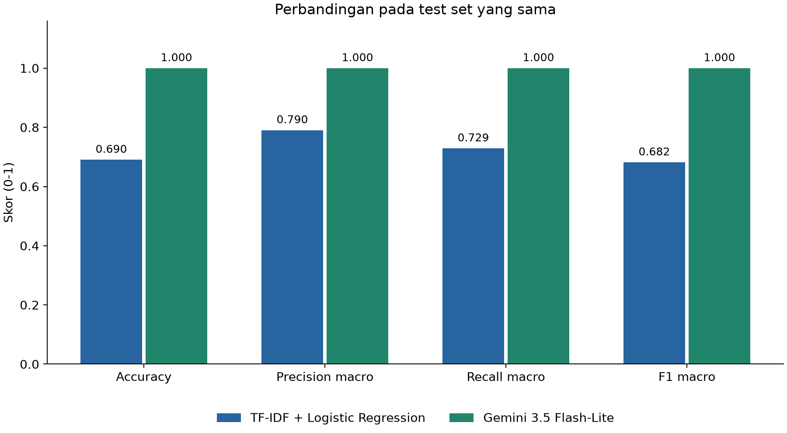
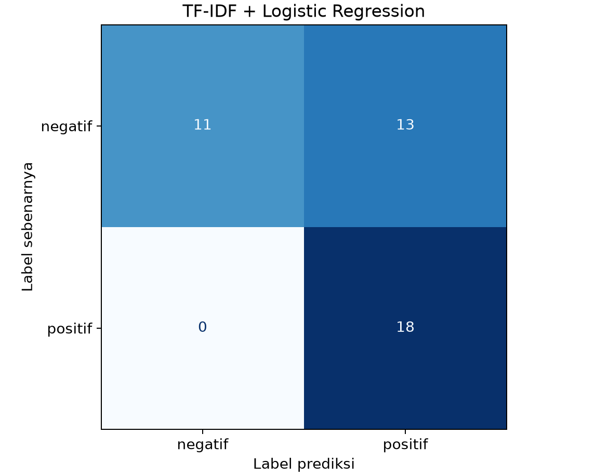
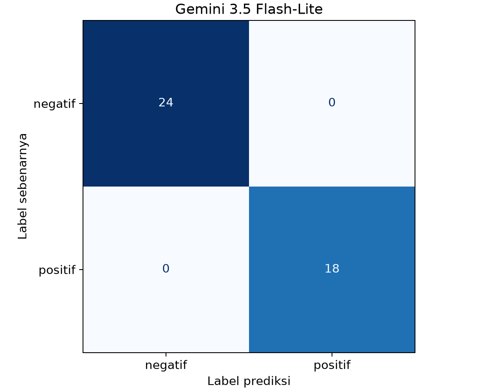

# AI Model Experiment & Evaluation

**Peserta:** Naufal Ahmad-C24  
**Repository:** `assignment-model-experiment-naufal-ahmad-c24`

Eksperimen membandingkan TF-IDF + Logistic Regression yang dilatih dengan Scikit-learn
dan Gemini API untuk klasifikasi sentimen ulasan pelanggan e-commerce.
Kedua pendekatan menghasilkan prediksi untuk **42 baris test yang sama**.

## 1. Problem statement

Tim produk ingin mengklasifikasikan ulasan menjadi **positif** atau **negatif** untuk
membantu mengenali kepuasan dan keluhan pelanggan. Tujuan project adalah membandingkan
performa, kebutuhan implementasi, waktu, dan potensi biaya dua pendekatan sebelum
memilih kandidat yang dikembangkan lebih lanjut.

Input prediksi hanya `review_text`; target adalah `sentiment`. `review_id` digunakan untuk
pelacakan hasil, sedangkan `product_name` hanya metadata. Asumsi: label mentor adalah
ground truth, tidak ada kelas netral, dan hasil merupakan eksperimen awal pada dataset kecil.

## 2. Sumber dan kondisi dataset

Sumber: dataset dan starter notebook yang disediakan mentor pada *Individual Assignment -
AI Model Experiment & Evaluation*, AI Engineering Bootcamp. Tidak mencari dataset lain.
File asli disalin utuh menjadi `data/customer_reviews_sentiment.csv`; hanya nama salinan
yang disederhanakan. Dataset tidak ditimpa oleh proses eksperimen.

| Pemeriksaan | Hasil |
|---|---:|
| Baris x kolom asli | 200 x 4 |
| Positif / negatif | 110 / 90 |
| Missing / duplikat penuh | 0 / 0 |
| ID ulasan unik | 200 |
| Teks unik setelah strip + lowercase | 40 |
| Pengulangan teks di luar kemunculan pertama | 160 |
| Teks identik dengan label bertentangan | 0 |

Tidak menghapus ulasan hanya karena teks sama pada produk/ID berbeda. Normalisasi
untuk grouping dilakukan pada salinan DataFrame. Kata negasi tidak dihapus dari fitur.

## 3. Pembagian data dan pencegahan leakage

Kelompok teks unik dibagi dengan `train_test_split(test_size=0.2, random_state=42,
stratify=label_kelompok)`. Hasil pembagian kelompok dipetakan kembali ke seluruh baris:

| Bagian | Jumlah baris | Teks unik | Positif | Negatif |
|---|---:|---:|---:|---:|
| Training | 158 | 32 | 92 | 66 |
| Test | 42 | 8 | 18 | 24 |

**Overlap teks train/test = 0.** Pembagian 80:20 berlaku untuk kelompok; proporsi baris
tidak tepat 80:20 karena frekuensi setiap teks berbeda. ID split tersimpan pada
[`split_manifest.csv`](documentation/split_manifest.csv).

Audit pembagian acak per baris seperti starter menemukan **39 dari
40 baris test memiliki teks yang sudah ada pada train**.
Karena itu, project memakai pembagian kelompok sebagai eksperimen utama. Audit tersebut
bukan eksperimen tambahan untuk memilih seed atau konfigurasi model berdasarkan skor test.

TF-IDF hanya di-fit pada train. Test tidak dipakai untuk training, pemilihan prompt,
atau tuning hyperparameter. Kedua model memakai urutan dan ID test yang identik.

## 4. Konfigurasi eksperimen

### Model klasik

- `TfidfVectorizer(lowercase=True, ngram_range=(1, 1), stop_words=None)`.
- `LogisticRegression(max_iter=1000)` dengan parameter lain default versi library terkunci.
- Konfigurasi sederhana mengikuti pendekatan starter, tanpa tuning pada test.
- `review_id`, produk, dan label test tidak menjadi fitur model.

### Gemini API

- Model: **`gemini-3.5-flash-lite`**, endpoint `generateContent`, SDK `google-genai`.
- Mengganti contoh `gemini-2.0-flash` pada starter karena model tersebut sudah dihentikan.
- Zero-shot: tidak memasukkan contoh berlabel dan tidak mengirim jawaban test ke API.
- Temperature **0.2** untuk mengurangi variasi sampling; tidak menjamin respons identik.
- Thinking level **minimal**, sesuai tugas klasifikasi singkat.
- `max_output_tokens=1024` memberi ruang respons, lalu hasil dibatasi lewat validasi dua label.
- Tidak menggunakan browsing, tools, few-shot, atau fine-tuning.
- Prompt lengkap tersedia pada [`prompt_template.txt`](documentation/prompt_template.txt).

**Prediksi Gemini berasal dari pemanggilan API nyata**, dengan response ID, model version,
raw response, waktu, dan token usage tersimpan pada
[`gemini_responses.json`](documentation/gemini_responses.json). API key tidak disimpan.
Untuk 42 baris dengan 8 teks unik, dilakukan
**8 panggilan unik**, lalu 34 baris duplikat teks
memakai ulang label yang sesuai. Ini tidak menghasilkan 42 pengamatan API independen.

Mode default notebook/script adalah replay rekaman nyata ini, agar mentor dapat
menjalankan evaluasi tanpa API key dan tanpa biaya panggilan tambahan. Cache diverifikasi
terhadap hash dataset, ID test, model, prompt, konfigurasi, cakupan teks dan validitas label.
Cache bukan mock atau prediksi model klasik. Inferensi baru tersedia melalui flag eksplisit.

## 5. Hasil evaluasi

### Seluruh baris test (42 baris)

| Pendekatan | Accuracy | Precision macro | Recall macro | F1 macro |
|---|---:|---:|---:|---:|
| TF-IDF + Logistic Regression | 0.6905 | 0.7903 | 0.7292 | 0.6816 |
| Gemini 3.5 Flash-Lite | 1.0000 | 1.0000 | 1.0000 | 1.0000 |







Urutan kelas matriks adalah **negatif, positif**. Baris = label sebenarnya;
kolom = label prediksi. Nilai diagonal adalah prediksi benar. Laporan precision, recall,
F1, dan support per kelas tersedia pada `experiment_report.json` dan output notebook.

### Pemeriksaan tambahan tanpa pembobotan pengulangan (8 teks unik)

| Pendekatan | Accuracy | Precision macro | Recall macro | F1 macro |
|---|---:|---:|---:|---:|
| TF-IDF + Logistic Regression | 0.7500 | 0.8333 | 0.7500 | 0.7333 |
| Gemini 3.5 Flash-Lite | 1.0000 | 1.0000 | 1.0000 | 1.0000 |

Metrik tambahan dihitung dari prediksi yang sama, satu baris per pola teks.
Ini membantu menunjukkan pengaruh frekuensi teks, bukan evaluasi pada dataset baru.

## 6. Analisis trade-off dan limitation

Model klasik menghasilkan accuracy **69.05%** dan F1 macro **0.6816**;
Gemini menghasilkan accuracy **100.00%** dan F1 macro **1.0000**.
Selisih F1 macro Gemini terhadap klasik adalah **0.3184**.

Accuracy menghitung proporsi prediksi benar pada seluruh baris. Precision menilai ketepatan
prediksi per kelas; recall menilai cakupan kelas sebenarnya; F1 menggabungkan keduanya.
Rata-rata macro memberi bobot sama pada kelas positif dan negatif.
Recall negatif klasik **45.83%**,
sedangkan Gemini **100.00%**.
Ini relevan jika tim ingin menangkap keluhan pelanggan yang berisiko terlewat.

**Kesalahan yang diamati**

- `Respon penjual lambat dan terkesan tidak peduli komplain.`: label **negatif**, klasik **positif**, Gemini **negatif**. Pola ini muncul 7 kali pada test.
- `Ukuran dan warna berbeda dari pesanan, sangat kecewa.`: label **negatif**, klasik **positif**, Gemini **negatif**. Pola ini muncul 6 kali pada test.

Jumlah baris salah klasik: **13**; jumlah baris salah Gemini: **0**.
Prediksi salah tersebut merupakan pengamatan. Dugaan penyebab klasik adalah keterbatasan
fitur unigram dan contoh training, bukan hasil uji kausal atau bukti fitur tertentu menjadi penyebab.
Kesalahan lengkap tersedia pada `documentation/error_analysis.csv`.

**Trade-off implementasi, waktu, dan biaya**

| Aspek | Model klasik | Gemini API |
|---|---|---|
| Persiapan | Memerlukan label, fitting TF-IDF, dan training classifier | Memerlukan API key, prompt, validasi respons, dan penanganan kuota |
| Training pada project | Dilatih pada train set lokal | Tidak dilatih/fine-tune pada dataset ini; memakai model pretrained |
| Inferensi | Lokal setelah training, tidak membutuhkan jaringan | Membutuhkan layanan eksternal dan jaringan untuk panggilan baru |
| Pemeliharaan | Perlu data berlabel dan evaluasi ulang ketika pola berubah | Perlu memantau model, versi API, prompt, kuota, dan biaya |
| Biaya | Tidak ada biaya per panggilan API; komputasi tetap memiliki biaya | Bergantung token dan tier akun; cache mengurangi panggilan berulang |

Training klasik termasuk fitting TF-IDF: **0.012471 detik**.
Prediksi klasik termasuk transformasi 42 baris: **0.002089 detik**.
Delapan panggilan unik Gemini direkam selama total **12.664 detik**,
dengan rata-rata **1.583 detik per panggilan berhasil**.
Pengukuran ini bersifat observasional pada satu lingkungan. Jumlah item yang dihitung berbeda:
klasik memproses semua baris, Gemini memproses teks unik dan memakai ulang hasil untuk duplikat.
Angka tersebut tidak dipakai sebagai perbandingan throughput yang terkontrol.

Penggunaan Gemini tercatat: input **1003 token**,
output final **16 token**, dan thinking
**0 token**. Estimasi dengan tarif Standard paid tier
adalah **USD 0.0003409** untuk panggilan berhasil yang tercatat.
Ini bukan tagihan aktual: tier, diskon, dan invoice akun tidak diverifikasi. Tarif acuan:
input USD0.30/juta token dan output termasuk thinking USD2.50/juta token,
diakses 25 November 2026 pada [dokumentasi model Google](https://aistudio.google.com/docs/models/gemini-3.5-flash-lite#pricing).

**Keterbatasan**

- Dataset hanya memiliki 40 teks unik, walaupun terdapat 200 baris; test hanya memiliki 8 pola unik.
- Teks yang sering berulang memberi bobot lebih besar pada metrik per baris. Karena itu, metrik 8 teks unik juga disajikan.
- Hanya satu holdout dan satu konfigurasi per pendekatan. Tidak ada tuning memakai label test atau pemilihan seed berdasarkan skor.
- Split berbasis teks mencegah teks identik pada train/test project, tetapi tidak membuktikan bahwa ulasan tidak pernah ada pada pretraining Gemini.
- Label mentor dianggap sebagai ground truth; tidak dilakukan audit label independen.
- Dataset memiliki ulasan singkat dan dua kelas. Belum mewakili sentimen netral/campuran, sarkasme, bahasa baru, atau variasi produksi.
- Model klasik dilatih dengan data kecil; Gemini membawa pengetahuan pretrained. Perbandingan ini merupakan pilihan pendekatan, bukan training dengan anggaran data yang setara.
- Gemini menggunakan satu respons per teks unik. Variasi respons antar-panggilan untuk teks yang sama tidak diuji; temperature rendah bukan jaminan determinisme.
- Skor Gemini yang sempurna pada sampel kecil ini tidak membuktikan performa sempurna di produksi.


## 7. Rekomendasi technical approach

**Rekomendasi: kembangkan Gemini API lebih lanjut sebagai kandidat pilot terbatas.**

Pada eksperimen ini, pilihan tersebut didasarkan pada F1 macro dan kemampuan menangkap
kelas negatif pada test set yang sama. Nilai F1 macro klasik adalah
**0.6816**, sedangkan Gemini **1.0000**.
Kebutuhan use case adalah mendeteksi sentimen ulasan, termasuk keluhan, sehingga recall
negatif menjadi pertimbangan selain accuracy keseluruhan.

Pilot tetap perlu evaluasi pada kumpulan ulasan baru yang lebih beragam, dengan label yang
ditinjau manusia, target latency dan anggaran yang disepakati, serta pemantauan salah klasifikasi.
Pertahankan model klasik sebagai baseline lokal untuk penelitian berikutnya. Bila jaringan,
pengiriman ulasan ke pihak eksternal, atau biaya API menjadi batasan utama, perluas data
training klasik dan evaluasi ulang sebelum memilih pendekatan produksi.

Keputusan ini tidak menyatakan model sudah siap dipasang ke produksi. Tidak ada target
minimum skor yang dibuat sendiri atau perubahan test set untuk mengejar skor lebih tinggi.


## 8. Struktur project dan output

```text
model-experiment-assignment/
|-- data/customer_reviews_sentiment.csv
|-- notebook/experiment_notebook.ipynb
|-- src/experiment.py
|-- src/reporting.py
|-- tests/test_experiment.py
|-- documentation/
|   |-- experiment_config.json
|   |-- experiment_report.json
|   |-- gemini_responses.json
|   |-- prompt_template.txt
|   |-- split_manifest.csv
|   |-- test_predictions.csv
|   |-- error_analysis.csv
|   |-- metrics_comparison.csv
|   |-- metrics_unique_texts.csv
|   |-- confusion_matrix_classic.png
|   |-- confusion_matrix_gemini.png
|   `-- model_comparison_summary.png
|-- README.md
|-- requirements.txt
`-- .gitignore
```

Notebook mempertahankan delapan section utama dan subbagian starter. Fungsi bersama
di `src/` memungkinkan notebook dan script menggunakan logika eksperimen yang sama.
Notebook sudah disimpan beserta hasil eksekusi dan gambar, sehingga dapat dibaca di GitHub.

## 9. Instalasi dan cara menjalankan

Lingkungan yang digunakan: Python 3.13.1, Pandas 3.1.1,
Scikit-learn 1.9.1, NumPy 2.5.5,
Matplotlib 3.11.2, Google GenAI 2.33.0.
`requirements.txt` mencatat versi lingkungan yang berhasil digunakan.

### Windows PowerShell

Dari folder utama project, untuk instalasi baru:

```powershell
python -m venv .venv
.\.venv\Scripts\python.exe -m pip install -r requirements.txt
```

Di folder lokal tugas, `.venv` telah disiapkan. Untuk mengulangi evaluasi dengan rekaman API:

```powershell
Set-Location 'D:\REWORK\Individual Assignment 2\model-experiment-assignment'
.\.venv\Scripts\python.exe src/experiment.py
.\.venv\Scripts\python.exe -m unittest discover -s tests -v
```

Untuk notebook: buka folder project di VS Code, buka `notebook/experiment_notebook.ipynb`,
pilih kernel Python `.venv`, lalu **Restart Kernel and Run All**.
Default `REFRESH_GEMINI=False` memakai rekaman nyata yang disertakan. Replay tidak membutuhkan key.

### Memanggil Gemini lagi

Sediakan `GEMINI_API_KEY` pada environment lokal. Pada notebook, ubah
`REFRESH_GEMINI=True`; bila key belum tersedia, cell meminta key melalui input tersembunyi.
Alternatif CLI setelah environment disiapkan:

```powershell
.\.venv\Scripts\python.exe src/experiment.py --refresh-gemini
```

Panggilan baru menggunakan kuota akun dan dapat menimbulkan biaya sesuai tier. Hasil API
dapat berubah. Refresh akan mengganti rekaman Gemini dan menghasilkan ulang evaluasi;
simpan seluruh output yang diperbarui secara konsisten. Jangan menaruh key di kode,
README, output notebook, atau GitHub. `.venv`, `.env`, dan cache runtime tidak diunggah.

Pada Linux/macOS, gunakan `python3 -m venv .venv` dan `.venv/bin/python` sebagai pengganti
interpreter Windows; pilih kernel yang sama pada notebook.

## 10. Validasi dan pengumpulan

Pengujian memeriksa pemisahan kelompok, integritas raw, alignment prediksi, provenance
dan identitas cache, normalisasi respons, serta metrik yang dihitung ulang dari hasil tersimpan.
Dataset asli dipertahankan dengan SHA-256:

```text
fc3f270e5ebb7cbe022e267106e68e251a832a9e9cd2e0cae460426397df2a50
```

Unggah isi project ke repository terpisah **`assignment-model-experiment-naufal-ahmad-c24`**,
dengan README di root. Pastikan mentor dapat mengakses repository. Sertakan seluruh
folder dan file pada struktur di atas; `.venv` dan `.runtime` tidak diperlukan untuk pengumpulan.
Kumpulkan satu link halaman utama repository melalui submission tugas 2.

## Referensi

- Brief dan starter notebook mentor: *Individual Assignment - AI Model Experiment & Evaluation*.
- [Pencegahan data leakage, Scikit-learn](https://scikit-learn.org/stable/common_pitfalls.html).
- [Metrik klasifikasi, Scikit-learn](https://scikit-learn.org/stable/modules/model_evaluation.html).
- [Model dan tarif Gemini yang digunakan](https://aistudio.google.com/docs/models/gemini-3.5-flash-lite).
- [Model deprecated, Google](https://aistudio.google.com/docs/deprecations).
- [Gemini thinking level](https://aistudio.google.com/docs/thinking?generate-content=true).
